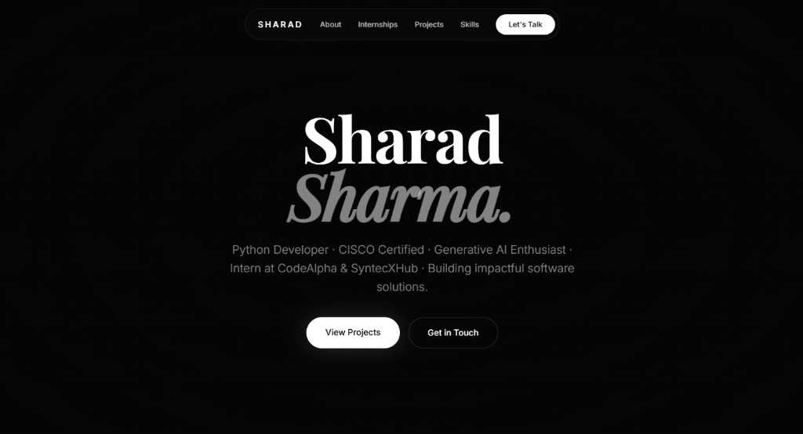

<div align="center">

# 🌐 Sharad Sharma — Developer Portfolio

**Python Developer · CISCO Certified · Generative AI Enthusiast · Computer Science Engineering Student**

[](https://github.com/sharad1sharma)
[](https://www.python.org/)
[](https://www.djangoproject.com/)
[](LICENSE)
[](#)

<br/>



<br/>
<br/>

> *"Building impactful software solutions at the intersection of Python engineering and Artificial Intelligence."*

</div>

---

## 📌 About The Portfolio

This repository hosts the official source code for **Sharad Sharma's Developer Portfolio**. Designed with an ultra-clean, minimalist aesthetic inspired by high-end dark mode interfaces, it showcases selected works, technical internships, industry certifications, and software engineering disciplines.

### 🌟 Key Highlights

- ⚡ **Ultra-Smooth Animations**: Powered by **GSAP** and **ScrollTrigger** for fluid reveal effects and buttery transitions.
- 🌊 **Inertial Scrolling**: Integrated with **Lenis Smooth Scroll** for a cohesive viewing experience.
- 📱 **Fully Responsive**: Adapts seamlessly to ultra-wide desktop monitors, laptops, tablets, and smartphones.
- 🎨 **Minimalist Typography & Glassmorphism**: Built using modern serif and sans-serif pairings (*Playfair Display*, *Inter*, and *JetBrains Mono*) with custom frosted glass UI cards.

---

## 👨‍💻 About Me

- 🎓 **Education**: B.Tech in Computer Science & Engineering, *School of Management Sciences, Lucknow*.
- 💼 **Focus Areas**: Python Development, RESTful APIs, Django & Flask Backends, and Generative AI applications.
- 🎯 **Status**: Open to software developer roles, backend internships, and collaborative open-source projects.
- 📬 **Email**: [sharmasharad9531@gmail.com](mailto:sharmasharad9531@gmail.com)

---

## 💼 Internship Experience

| Company | Role | Period | Key Highlights |
| :--- | :--- | :--- | :--- |
| **SyntecxHub Technologies** | Python Programming Intern | Jun 2026 – Jul 2026 | Developed automated web scraping scripts, CLI expense tracking utilities, and system automation tools. |
| **CodeAlpha** | Backend Development Intern | Aug 2026 – Sep 2026 | Built robust web backends utilizing Flask, Django, and Django REST Framework with atomic database transactions. |

---

## 🚀 Featured Projects

A selection of open-source projects highlighted in this portfolio:

- 🍽️ **[GourmetOS — Restaurant Management System](https://github.com/sharad1sharma/GourmetOS-Restaurant-Management-System)**: A full-fledged POS and restaurant management platform with live table reservations, atomic inventory deduction, and analytics.
- 🎟️ **[Eventify Pro](https://github.com/sharad1sharma/Eventify-Pro)**: Modern event discovery, scheduling, and registration platform built with Django REST Framework.
- 🤖 **[AI Chatbot](https://github.com/sharad1sharma/AI-CHATBOT-USING-API-AND-HTML-CSS-AND-JS)**: Conversational assistant integrating the Cohere API with a dynamic frontend.
- 🔗 **[Quera](https://github.com/sharad1sharma/QUERA)**: Smart URL shortener and file-sharing tool utilizing on-the-fly QR code generation.
- 🔍 **[GitHub Username Finder](https://github.com/sharad1sharma/GitHub-Username-Finder)**: Real-time GitHub profile search tool with automatic HTML summary card generation.
- 💰 **[Expense Tracker CLI](https://github.com/sharad1sharma/EXPENSE-TRACKER-USING-PYTHON)**: Terminal-based finance and budget tracker with category summaries.

---

## 📜 Certifications & Credentials

- 🏅 **Python Essentials 1 & 2** — *Cisco Networking Academy*
- 🏅 **Generative AI Studio** — *Google Cloud*
- 🏅 **AI for All** — *TCS iON*
- 🏅 **Generative AI Mastermind** — *Outskill*
- 🏅 **HTML & CSS Web Development** — *LetsUpgrade*
- 🏅 **Exploring Chatbots** — *Skillsoft*
- 🏅 **Presenting Data** — *HP Life*

---

## 🛠️ Core Skills & Tech Stack

```
Languages:        Python, JavaScript, HTML5, CSS3, SQL
Frameworks:       Django, Django REST Framework, Flask
AI & LLMs:        Generative AI, Prompt Engineering, Claude, Gemini, ChatGPT, DeepSeek
Animation & UI:   GSAP, ScrollTrigger, Lenis Smooth Scroll
Developer Tools:  Git, GitHub, VS Code, Linux
```

---


## 📬 Connect With Me

- **GitHub**: [@sharad1sharma](https://github.com/sharad1sharma)
- **Email**: [sharmasharad9531@gmail.com](mailto:sharmasharad9531@gmail.com)

---

## 📄 License

This project is open-source and licensed under the [MIT License](LICENSE).
